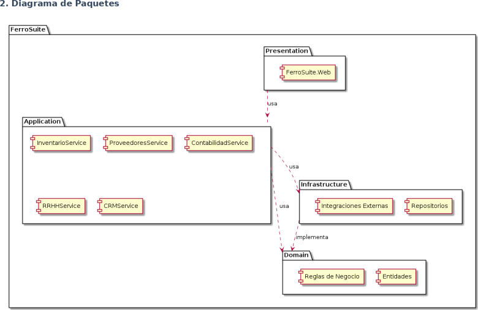
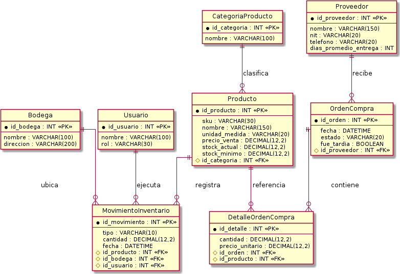
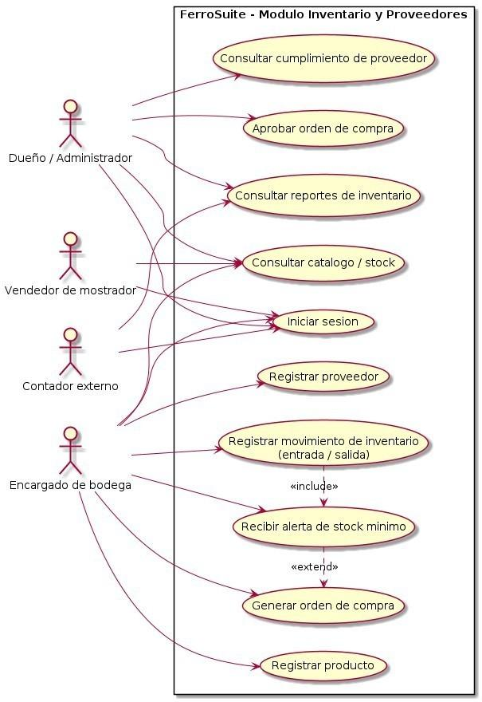
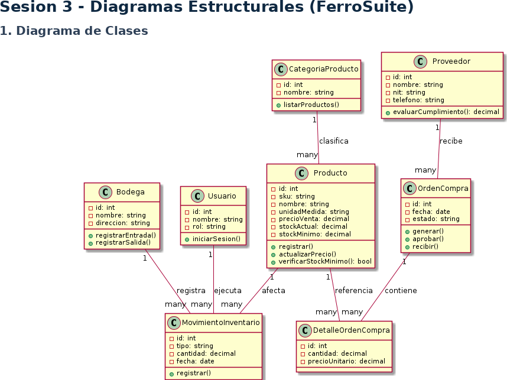
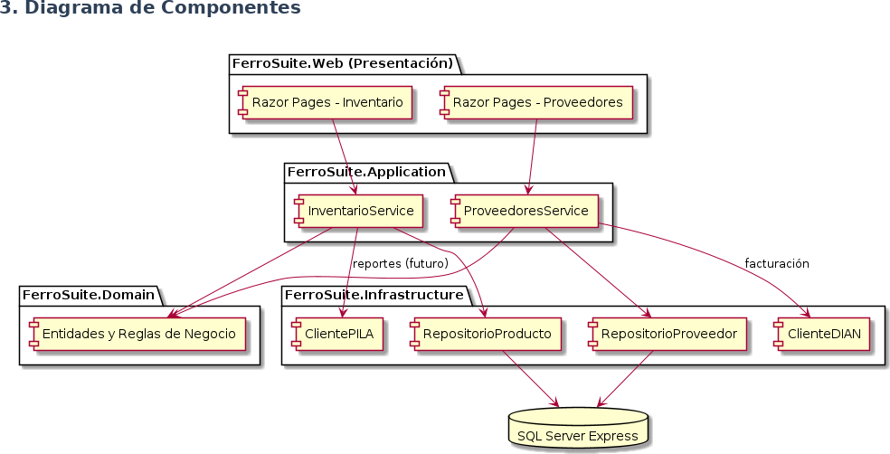
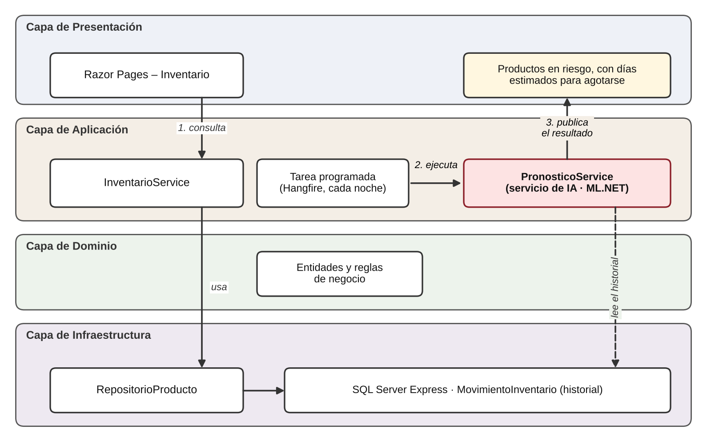

# FerroSuite

**ERP modular en la nube para ferreterías pyme en Colombia.** Proyecto de la asignatura Arquitectura de Software, sexto semestre de Ingeniería de Software, Universidad Manuela Beltrán (Bogotá D.C., 2026).

**Integrantes:** Santiago Rios Duque, Juan Diego Rojas y Zhadyth Alejandra Puentes Velandia.

## Contenido

1. [Estado del proyecto por fases](#estado-del-proyecto-por-fases)
2. [Entregables realizados](#entregables-realizados)
3. [Estructura del repositorio](#estructura-del-repositorio)
4. [Cómo ejecutar el prototipo](#cómo-ejecutar-el-prototipo)
5. [Documentación del proyecto (secciones 1 a 18)](#documentación-del-proyecto-secciones-1-a-18)
6. [Referencias](#referencias)

## Estado del proyecto por fases

| Fase | Qué se hizo | Dónde está |
|---|---|---|
| 1 | Definición del proyecto: contexto, justificación, problemática, necesidad y pregunta problema. Primera interfaz del frontend (repositorio, estructura inicial y pantalla de Inicio). | Secciones 1 a 5 de este documento; `frontend/index.html` |
| 2 | Arquitectura de software: arquitectura en capas, modelo relacional, diagramas UML, lenguajes, herramientas y metodología. Pantallas de Inventario y Proveedores con datos de prueba. | Secciones 6 a 12; `diagrams/`; `docs/ERP.docx` |
| 3 | Requerimientos funcionales y no funcionales, marcos conceptual, contextual e integrador de IA. Código del prototipo organizado en componentes, servicios y controladores, y nuevas pantallas de Órdenes de compra e Ingreso. | Secciones 13 a 18; `frontend/`; `docs/relacion-requerimientos-prototipo.md` |

## Entregables realizados

| Entregable | Qué contiene | Dónde está |
|---|---|---|
| Documento del proyecto, fases 1 y 2 | Problemática, necesidad, pregunta problema, objetivos, arquitectura en capas, modelo relacional, UML, lenguajes, herramientas y metodología. | [`docs/ERP.docx`](docs/ERP.docx) y secciones 1 a 12 de este README |
| Documento maestro actualizado (fase 3) | El documento anterior más los requerimientos funcionales y no funcionales, los marcos conceptual y contextual y el marco integrador del servicio de IA. 26 páginas, con referencias en APA. | [`docs/FerroSuite_Documento_Maestro.docx`](docs/FerroSuite_Documento_Maestro.docx) y secciones 13 a 18 de este README |
| Diagramas de arquitectura y UML | Diagrama de paquetes, modelo relacional, casos de uso, clases y componentes, más el diagrama de integración del servicio de IA. | [`diagrams/`](diagrams/) y [`docs/img/`](docs/img/) |
| Prototipo web | Pantallas de Inicio, Inventario, Proveedores, Órdenes de compra e Ingreso, con componentes reutilizables, controladores, servicios y datos de prueba. | [`frontend/`](frontend/) |
| Relación requerimientos, pantallas y código | Tabla que enlaza cada requerimiento funcional con su pantalla y su archivo. | [`docs/relacion-requerimientos-prototipo.md`](docs/relacion-requerimientos-prototipo.md) |
| Prototipo de escritorio en C# (Windows Forms) | Validó en código la regla de riesgo de stock (`cantidad <= mínimo`), el ingreso por rol (dueño y bodeguero), y agregar, modificar, eliminar y verificar riesgo de productos. | No está en este repositorio |
| Material de presentación | Presentación de avance de 10 diapositivas (en Canva) e infografía de trazabilidad del proyecto, con lenguaje sencillo y centrados en una ferretería de barrio. | No está en este repositorio |

### Cumplimiento de la actividad de la fase 3

| Apartado de la actividad | Qué se hizo |
|---|---|
| 3.1 Continuidad del repositorio | Se trabajó sobre el mismo repositorio, conservando lo anterior y registrando los cambios en commits. |
| 3.2 Organización del proyecto | Estilos separados en `base`, `layout`, `components` y `responsive`. JavaScript separado en `components`, `controllers`, `services` y `models`. |
| 3.3 Evolución de las interfaces | Pantalla principal, menú de navegación, secciones de Inventario, Proveedores y Órdenes de compra, y formularios con validación. |
| 3.4 Separación inicial de componentes | Encabezado, pie, tabla, formulario, tarjeta de resumen, etiqueta de estado, aviso y panel de alerta. |
| 3.5 Relación con la arquitectura | Capas Presentación, Aplicación y Dominio reflejadas en las carpetas, y requerimientos enlazados a las pantallas. |
| 3.6 Verificación y control de versiones | Navegación y formularios probados en el navegador, y commits con mensajes claros. |

## Estructura del repositorio

```text
FerroSuite-erp/
├── README.md                     Este documento
├── docs/                         Documentación del proyecto
│   ├── ERP.docx                  Documento de las fases 1 y 2
│   ├── FerroSuite_Documento_Maestro.docx   Documento maestro actualizado (fases 1, 2 y 3)
│   ├── relacion-requerimientos-prototipo.md
│   └── img/                      Figuras del documento
├── diagrams/                     Diagramas UML y de arquitectura de las sesiones 3 y 4
├── frontend/                     Prototipo de interfaz web (HTML, CSS y JavaScript)
│   ├── *.html                    Pantallas: Inicio, Inventario, Proveedores, Órdenes de compra, Ingreso
│   ├── css/                      base, layout, components y responsive
│   └── js/
│       ├── components/           Encabezado, pie, tabla, formulario, tarjeta, etiqueta, aviso, panel de alerta
│       ├── controllers/          Un controlador por pantalla
│       ├── services/             Reglas del negocio (inventario, proveedores, órdenes)
│       └── models/               Datos de prueba
└── FerroSuite.web/               Proyecto base ASP.NET Core para el backend (siguientes fases)
```

La relación entre los requerimientos, las pantallas y el código está en [`docs/relacion-requerimientos-prototipo.md`](docs/relacion-requerimientos-prototipo.md).

## Cómo ejecutar el prototipo

No necesita instalación. Abre `frontend/index.html` en el navegador. Los datos son de prueba y viven en memoria: se pierden al recargar la página. El prototipo todavía no tiene base de datos, backend ni autenticación real.

## Documentación del proyecto (secciones 1 a 18)

### Abstract

Most small and medium-sized hardware stores (ferreterías) in Colombia still manage their inventory, suppliers, payroll and accounting manually, using spreadsheets or paper records. This lack of digitalization leads to inventory mismatches, loss of traceability with suppliers, and accounting errors, while existing Enterprise Resource Planning (ERP) systems are either too generic to handle mixed units of measurement (meters, kilograms, units, rods) or too expensive for a small business. This document presents the first two sections of the formal documentation of FerroSuite, a modular, cloud-based ERP designed specifically for hardware store pymes in Colombia: the identification of the problem, need and guiding question, and the software architecture designed to address them for the Inventory and Suppliers modules.

*Keywords:* ERP, arquitectura de software, ferreterías, pyme, inventario, proveedores.

### 1. Introducción

El presente documento corresponde a la documentación formal del proyecto FerroSuite, desarrollado en el marco de la asignatura Arquitectura de Software. FerroSuite es un sistema de planificación de recursos empresariales (ERP) modular y basado en la nube, dirigido específicamente a ferreterías pequeñas y medianas en Colombia, con el propósito de apoyar la gestión de su inventario, sus proveedores, su contabilidad, su nómina y sus clientes.

El sector ferretero colombiano agrupa cerca de 34.000 establecimientos formales, que en conjunto generan ventas anuales cercanas a los 6.378 millones de dólares y alrededor de 450.000 empleos directos. A pesar de su tamaño, la mayoría de estos negocios continúa operando con procesos manuales: hojas de cálculo, cuadernos físicos o, en el mejor de los casos, herramientas contables básicas que no fueron pensadas para un catálogo de miles de referencias con unidades de medida heterogéneas, como el metro, el kilogramo, la unidad o la varilla.

Esta situación, un mercado grande y relevante para la economía del país pero escasamente digitalizado, es la que da origen al proyecto. FerroSuite propone una solución modular, en la que el negocio puede adquirir únicamente los módulos que necesita en un momento dado (Inventario, Proveedores, Contabilidad, RRHH o CRM), en lugar de asumir el costo y la complejidad de un sistema completo desde el inicio.

Desde la perspectiva de la Arquitectura de Software, este proyecto resulta pertinente porque exige decisiones de diseño concretas antes de iniciar cualquier desarrollo: cómo separar responsabilidades entre los distintos módulos, cómo estructurar el sistema por capas para que sea mantenible y escalable, y cómo permitir que la solución crezca de un módulo a cinco sin tener que rediseñarla desde cero. Este documento presenta, en su primera parte, el contexto, la problemática, la necesidad y la pregunta que orientan el proyecto, en su segunda parte, la arquitectura de software diseñada para responder a esa pregunta y, en su tercera parte, los requerimientos funcionales y no funcionales junto con los marcos conceptual, contextual e integrador de inteligencia artificial.

### 2. Justificación

El desarrollo de FerroSuite se justifica, en primer lugar, por la magnitud del problema que atiende. Solo el 5,9% de las pymes colombianas utiliza actualmente un ERP en la nube, mientras que cerca del 70% sigue operando con procesos manuales. Esa brecha representa, al mismo tiempo, un riesgo para los negocios que no logran controlar su operación y una oportunidad para una solución construida específicamente para sus necesidades.

Los principales beneficiados serían los dueños y administradores de ferreterías, los vendedores de mostrador y los encargados de bodega, quienes hoy dependen de registros manuales para tomar decisiones sobre compras, ventas y pagos. También se beneficiarían los contadores externos que llevan la contabilidad de varias ferreterías a la vez, al contar con información centralizada y actualizada.

Desde el punto de vista académico, el proyecto es pertinente porque obliga a poner en práctica los principios de la Arquitectura de Software en un caso de uso real: un dominio con reglas de negocio propias (unidades de medida mixtas, control de proveedores, cumplimiento normativo), en el que una arquitectura mal planteada se traduciría directamente en pérdidas para el negocio. Adicionalmente, el proyecto se desarrolla utilizando exclusivamente herramientas gratuitas o con licencia educativa, lo que lo hace viable dentro del presupuesto y el tiempo disponibles durante el semestre académico.

### 3. Problemática

La mayoría de las ferreterías pyme en Colombia, entendidas como negocios de entre 1 y 50 empleados, gestionan su inventario, sus proveedores, su cartera y su nómina de forma manual o mediante hojas de cálculo que no están conectadas entre sí. En la práctica, esto significa que el dueño del negocio no tiene certeza, en un momento dado, de cuánto stock tiene realmente disponible de cada producto, ni de cuáles productos están próximos a agotarse.

Esta falta de control genera descuadres frecuentes entre el inventario físico y el registrado, así como una pérdida de trazabilidad en la relación con los proveedores: no siempre queda claro qué se les debe, en qué plazos suelen entregar los pedidos, o si están cumpliendo con lo acordado. A esto se suman errores en la liquidación de nómina y en la contabilidad, derivados de procesos que dependen en gran medida del registro manual.

Cuando estos negocios buscan una solución tecnológica ya existente, se encuentran con dos escenarios poco favorables. Por un lado, los ERP genéricos disponibles en el mercado colombiano, como Alegra o Siigo, no están preparados para manejar catálogos de miles de referencias con unidades de medida mixtas, propias de una ferretería. Por otro lado, soluciones más completas, como World Office, implican licencias que pueden costar entre 1,5 y 5 millones de pesos, un valor que resulta difícil de asumir para un negocio pequeño. Es importante aclarar que esta problemática no se limita a la ausencia de tecnología: refleja, ante todo, una forma de operar el negocio que ha funcionado históricamente pero que ya no responde a la escala y a la complejidad que estos negocios han alcanzado.

### 4. Necesidad

A partir de la problemática descrita, se identifica la necesidad concreta de contar con una herramienta que permita a una ferretería pyme llevar el control de su inventario y de sus proveedores de forma centralizada, confiable y accesible para personal que no necesariamente tiene formación contable o técnica, como vendedores de mostrador o encargados de bodega.

Esta necesidad involucra a distintos actores dentro del negocio: el dueño, que requiere visibilidad sobre el estado real de su inventario y de sus cuentas con proveedores para tomar decisiones; el personal operativo, que necesita una herramienta sencilla de usar en el día a día; y, en un contexto más amplio, el sector ferretero colombiano en su conjunto, que presenta niveles de digitalización muy bajos frente al tamaño económico que representa.

Esta necesidad es la que se pretende atender mediante el diseño de una solución modular en la nube, cuya arquitectura se presenta en la segunda parte de este documento, comenzando por los módulos de Inventario y de Proveedores, identificados como los de mayor impacto para el negocio.

### 5. Pregunta Problema

¿Cómo puede diseñarse una solución de software modular y basada en la nube que permita a las ferreterías pyme en Colombia controlar de manera confiable su inventario y la gestión de sus proveedores, adaptándose a las particularidades de su catálogo de productos, sin incurrir en los altos costos de licenciamiento ni en las limitaciones de los sistemas ERP genéricos actualmente disponibles en el mercado?

### 6. Objetivo General

Diseñar la arquitectura de software de FerroSuite para los módulos de Inventario y Proveedores, de forma que se responda a la pregunta y a la necesidad que se plantearon antes. La idea es que esta arquitectura quede organizada en partes (módulos), para que más adelante se puedan agregar Contabilidad, RRHH y CRM sin tener que cambiar todo lo que ya esté hecho.

### 7. Objetivos Específicos

1. Elegir el tipo de arquitectura de software que se va a usar en FerroSuite y explicar por qué es la más adecuada, teniendo en cuenta que el sistema tiene que poder crecer módulo por módulo.
2. Elaborar un diagrama que muestre cómo se organiza la solución por dentro: sus capas, sus partes principales y cómo se conectan entre ellas.
3. Elaborar los diagramas UML solicitados de casos de uso, de clases y de componentes para los módulos de Inventario y Proveedores.
4. Idear y diseñar cómo van a quedar organizadas las tablas de la base de datos en la cual se va a guardar la información de inventario, movimientos de stock, proveedores y órdenes de compra.
5. Definir con qué lenguaje de programación, con qué herramientas y con qué metodología se va a construir la solución.

### 8. Arquitectura de Software

#### 8.1 Selección de la Arquitectura

Para FerroSuite se escogió una arquitectura en capas, dividida en cuatro partes: Presentación, Aplicación, Dominio e Infraestructura. Se eligió esta arquitectura por tres razones principales. La primera es que el proyecto necesita poder crecer poco a poco: hoy solo están los módulos de Inventario y Proveedores, pero más adelante se van a agregar Contabilidad, RRHH y CRM, y no se quiere tener que dañar lo que ya funciona cada vez que se agregue un módulo nuevo. Al tener el sistema dividido en capas, cada módulo nuevo puede tener su propia parte de Aplicación y su propia parte de Dominio, sin tocar la parte de Presentación ni la de Infraestructura.

La segunda razón es que, al dividir el sistema en capas, cada parte se encarga solo de una cosa. Por ejemplo, el cálculo del riesgo de que se acabe un producto (quiebre de stock) queda en la capa de Aplicación, separado de cómo se ve la pantalla o de cómo se guardan los datos. Esto ayuda a que sea más fácil probar el sistema y hace que, si más adelante se cambia de base de datos (por ejemplo, dejar de usar SQL Server Express), no haya que rehacer todo lo demás.

La tercera razón es que esta forma de organizar el sistema es la que mejor funciona con las herramientas que ya se habían escogido (C# y ASP.NET Core), porque es una manera de trabajar muy usada y con mucha información disponible. Eso hace que, como equipo de estudiantes con poco tiempo durante el semestre, haya menos riesgo de equivocarse.

#### 8.2 Representación Gráfica de la Arquitectura

En la Figura 1 se puede ver el diagrama de paquetes de FerroSuite, que muestra las cuatro capas y cómo se conectan entre ellas. La capa de Presentación (FerroSuite.Web) usa la capa de Aplicación, que es donde están los servicios de cada módulo (InventarioService, ProveedoresService, ContabilidadService, RRHHService y CRMService). La capa de Aplicación usa la capa de Infraestructura para conectarse con los repositorios y con los servicios externos, y también usa las reglas que están definidas en la capa de Dominio, donde están las entidades y las reglas del negocio. La capa de Dominio no depende de ninguna otra capa.


*Figura 1. Diagrama de paquetes*

#### 8.3 Modelo Relacional

El modelo relacional (Figura 2) muestra cómo quedan las entidades del dominio convertidas en tablas de base de datos, para los módulos de Inventario y Proveedores. Las tablas principales son Producto, CategoriaProducto, Bodega, Usuario, MovimientoInventario, Proveedor, OrdenCompra y DetalleOrdenCompra. La tabla Producto está conectada con CategoriaProducto, porque una categoría puede tener muchos productos. También está conectada con MovimientoInventario, que guarda cada entrada o salida de stock (y quién la hizo y en qué bodega), y con DetalleOrdenCompra, que conecta un producto con una orden de compra. Cada OrdenCompra le pertenece a un Proveedor, y con eso se puede saber si ese proveedor cumple o no cumple.


*Figura 2. Modelo relacional*

#### 8.4 Modelo MVC

El patrón Modelo-Vista-Controlador (MVC) se puede llegar a aplicar a FerroSuite, pero no completamente ya que el proyecto usa Razor Pages de ASP.NET Core, que es parecido a MVC pero está organizado por página y no por controlador. Sin embargo se pueden reconocer las tres partes del patrón: el Modelo son las entidades de la capa de Dominio (como Producto, Proveedor y OrdenCompra); la Vista son los archivos .cshtml de cada página (por ejemplo la página de Inventario o la de Proveedores), que solo se encargan de mostrar la información; y el Controlador está formado por las clases PageModel de cada página y por los servicios de la capa de Aplicación (InventarioService, ProveedoresService), que reciben lo que hace el usuario, ejecutan la lógica del negocio y le devuelven el resultado a la Vista.

### 9. Diagramación UML

#### 9.1 Diagrama de Casos de Uso

En la Figura 3 se encuentran los casos de uso que se identificaron para los módulos de Inventario y Proveedores, juntados según los cuatro tipos de usuario: el dueño o administrador, el vendedor de mostrador, el encargado de bodega y el contador externo. El encargado de bodega es quien más casos de uso tiene (registrar productos, registrar movimientos de inventario, registrar proveedores y generar órdenes de compra), mientras que el dueño se encarga más de revisar: consultar reportes, aprobar órdenes de compra y ver si los proveedores están cumpliendo. El caso de uso "Registrar movimiento de inventario" incluye revisar si el stock llegó al mínimo, y si eso pasa, se genera una orden de compra.


*Figura 3. Diagrama de casos de uso*

#### 9.2 Diagrama de Clases

El diagrama de clases (Figura 4) muestra las entidades del dominio y cómo se relacionan entre ellas: un Producto pertenece a una CategoriaProducto, y aparece en los MovimientoInventario (que un Usuario registra en una Bodega) y en los DetalleOrdenCompra, que a su vez están dentro de una OrdenCompra hecha a un Proveedor.


*Figura 4. Diagrama de clases*

#### 9.3 Diagrama de Componentes

El diagrama de componentes (Figura 5) muestra cómo quedan repartidas las partes de la arquitectura dentro del código del proyecto. Las páginas Razor Pages - Inventario y Razor Pages - Proveedores (que están en la capa de Presentación) usan InventarioService y ProveedoresService (que están en la capa de Aplicación). Estos servicios necesitan las Entidades y Reglas de Negocio de la capa de Dominio, y usan los repositorios de la capa de Infraestructura (RepositorioProducto, RepositorioProveedor) para guardar la información en SQL Server Express. También están pensados, para más adelante, los clientes que se conectan con servicios externos (ClienteDIAN, ClientePILA).


*Figura 5. Diagrama de componentes*

### 10. Lenguajes

- **C#:** es el lenguaje principal del backend. Se usa en las capas de Aplicación, Dominio e Infraestructura, con ASP.NET Core.

- **HTML, CSS y JavaScript:** se usan en la capa de Presentación, tanto en las páginas Razor (.cshtml) como en la primera versión de la interfaz que ya se hizo.

- **SQL:** es el lenguaje que se usa para crear y consultar las tablas del modelo relacional en SQL Server Express.

### 11. Herramientas y Tecnologías

- **ASP.NET Core con Razor Pages:** se usa para construir el backend y la interfaz web.

- **SQL Server Express:** es la base de datos que se usa; es gratis hasta 10 GB.

- **Visual Studio Community:** es el programa donde se escribe y se prueba el código.

- **PlantUML:** se usa para hacer los diagramas UML y el modelo relacional del proyecto.

- **GitHub:** se usa para guardar y controlar las versiones del proyecto. GitHub Actions se usa para que el proyecto se compile solo, cada vez que se sube algo nuevo al repositorio.

- **Hangfire:** es una librería gratis que se usa para programar tareas automáticas, como volver a calcular cada cierto tiempo el riesgo de que se acabe un producto.

### 12. Metodología

El proyecto se está trabajando por fases, poco a poco, con una idea parecida a la del Proceso Unificado (RUP), pero ajustada al tiempo que dura el semestre. Cada entrega se construye sobre la anterior: la primera parte de este documento fue para plantear el problema, la necesidad y la pregunta del proyecto; esta segunda parte es para diseñar la arquitectura de software y hacer los diagramas UML; la tercera parte es para definir los requerimientos y los marcos de referencia, incluida la propuesta de un servicio de inteligencia artificial; y las siguientes entregas van a ser para construir y probar el MVP (la primera versión funcional) de los módulos de Inventario y Proveedores. Trabajar así ayuda a revisar bien las decisiones de arquitectura antes de empezar a programar, para no tener que rehacer todo después.

### 13. Requerimientos funcionales

FerroSuite debe ofrecer doce funcionalidades para los módulos de Inventario y Proveedores, que corresponden a los casos de uso de la Figura 3 y a las entidades del modelo relacional de la Figura 2. Los actores son los mismos cuatro ya definidos: dueño o administrador, vendedor de mostrador, encargado de bodega y contador externo.

**Tabla 1.** *Requerimientos funcionales de FerroSuite*

| Código | Nombre | Descripción de la funcionalidad | Actor | Resultado esperado |
|---|---|---|---|---|
| RF01 | Iniciar sesión con rol | El sistema solicita usuario y clave y habilita las opciones según el rol de la persona. | Todos los actores | Acceso a las funciones permitidas para su rol y rechazo de credenciales incorrectas. |
| RF02 | Registrar producto | Permite crear un producto con SKU, nombre, categoría, unidad de medida (metro, kilogramo, unidad, varilla), precio de venta, stock actual y stock mínimo. | Encargado de bodega | Producto guardado y visible en el catálogo. |
| RF03 | Consultar catálogo y existencias | Permite buscar y listar productos con su stock actual por bodega. | Dueño, vendedor de mostrador, encargado de bodega, contador externo | Lista de productos con cantidades actualizadas. |
| RF04 | Modificar y eliminar productos | Permite cambiar los datos de un producto o eliminarlo, pidiendo confirmación antes de borrar. | Dueño o administrador | Catálogo actualizado sin cambios accidentales. |
| RF05 | Registrar movimiento de inventario | Registra cada entrada o salida de mercancía con producto, cantidad, bodega, usuario y fecha. | Encargado de bodega | Stock actualizado y movimiento guardado en el historial. |
| RF06 | Alertar riesgo de quiebre de stock | Revisa el stock tras cada movimiento y muestra los productos cuya cantidad es menor o igual al mínimo definido, con un margen adicional cuando el proveedor suele entregar tarde. | Encargado de bodega, dueño | Lista de productos en riesgo para reponer a tiempo. |
| RF07 | Registrar proveedor | Permite crear un proveedor con nombre, NIT, teléfono y días promedio de entrega. | Encargado de bodega | Proveedor disponible para asociar a órdenes de compra. |
| RF08 | Generar orden de compra | A partir de una alerta de stock mínimo, arma una orden con proveedor, productos y cantidades. | Encargado de bodega | Orden de compra creada en estado pendiente de aprobación. |
| RF09 | Aprobar orden de compra | Permite revisar una orden pendiente y aprobarla o rechazarla. | Dueño o administrador | Orden aprobada lista para enviarse al proveedor. |
| RF10 | Consultar cumplimiento de proveedores | Muestra cuántas órdenes llegó tarde cada proveedor y su tiempo promedio de entrega. | Dueño o administrador | Información para decidir con qué proveedor seguir comprando. |
| RF11 | Consultar reportes de inventario | Genera reportes de existencias y de movimientos por producto, bodega y rango de fechas. | Dueño, contador externo | Reporte en pantalla con los datos del periodo elegido. |
| RF12 | Validar la información registrada | Rechaza datos vacíos, cantidades negativas y productos o proveedores repetidos antes de guardarlos. | Todos los actores que registran información | Datos consistentes y mensaje claro cuando hay un error. |

Con el prototipo en C# (Windows Forms) ya se validaron en código RF01, RF03, RF04, RF06 y RF12, además del registro básico de productos de RF02. Los demás requerimientos quedan para las siguientes entregas.

### 14. Requerimientos no funcionales

Los ocho requerimientos no funcionales de FerroSuite definen las condiciones de calidad, seguridad y operación del sistema. Se agrupan según las características del modelo de calidad ISO/IEC 25010 (ISO/IEC, 2023) y cada uno incluye un criterio que puede verificarse con una prueba.

**Tabla 2.** *Requerimientos no funcionales de FerroSuite*

| Código | Categoría | Requerimiento | Criterio verificable |
|---|---|---|---|
| RNF01 | Seguridad | El sistema exige autenticación y controla el acceso por rol. Las claves se guardan cifradas, y los datos personales de usuarios y proveedores se protegen con medidas técnicas y administrativas, conforme al principio de seguridad de la Ley 1581 de 2012. | Ninguna página de inventario abre sin sesión iniciada. Cada rol solo ve las opciones que le corresponden. No existen claves en texto plano en la base de datos. |
| RNF02 | Rendimiento | Las consultas y registros responden rápido con un catálogo de miles de referencias. | Con 5.000 productos cargados, listar o buscar un producto tarda 2 segundos o menos, y registrar un movimiento, 3 segundos o menos. |
| RNF03 | Usabilidad | La interfaz es clara para personal sin formación técnica, con mensajes de error en español y sin términos técnicos. | Una persona nueva registra un producto en menos de 2 minutos después de una explicación de 15 minutos. |
| RNF04 | Integridad de los datos | La información guardada es consistente y válida. Cada movimiento de inventario se registra completo o no se registra (transacción atómica). | El sistema rechaza el 100 % de los intentos de guardar cantidades negativas, SKU repetidos o campos obligatorios vacíos. Si falla un movimiento a mitad de proceso, el stock queda igual que antes. |
| RNF05 | Disponibilidad | El sistema está disponible durante el horario comercial de la ferretería y se puede recuperar tras una falla. | Disponibilidad de 99 % o más en horario de lunes a sábado de 7:00 a 19:00, y copia de seguridad diaria de la base de datos. |
| RNF06 | Mantenibilidad | La división en capas permite corregir o agregar un módulo sin rehacer los demás. | Agregar el módulo de Contabilidad no exige modificar las capas de Presentación ni de Infraestructura ya construidas. Las pruebas unitarias cubren al menos 70 % de la capa de Aplicación. |
| RNF07 | Compatibilidad | La aplicación web funciona en los navegadores y dispositivos que usa el negocio. | Funciona sin errores en las dos últimas versiones de Chrome, Edge y Firefox, y en pantallas desde 360 píxeles de ancho (celular) hasta escritorio. |
| RNF08 | Trazabilidad | Se puede saber qué operación se hizo, quién la hizo y cuándo. | El 100 % de los movimientos de inventario guarda usuario, bodega, fecha y hora, y no pueden borrarse, solo corregirse con un movimiento nuevo. |

Las cifras de rendimiento, disponibilidad y cobertura son metas de diseño del equipo para esta etapa académica, y se ajustarán cuando se pruebe el sistema con una ferretería real.

### 15. Marco conceptual

Este marco reúne los conceptos que sustentan FerroSuite y explica cómo se aplica cada uno en el producto. Se organiza en conceptos del proyecto, de sistemas transaccionales y tecnológicos.

#### 15.1 Conceptos fundamentales del proyecto

**ERP (planificación de recursos empresariales).** Es una solución tecnológica que integra los procesos y la información clave de una empresa, como inventario, compras, ventas, contabilidad y nómina (Digital Ware, s.f.). FerroSuite adopta esta idea de forma modular, empezando por Inventario y Proveedores.

**Gestión de inventarios.** Consiste en controlar las existencias de cada producto, sus entradas y salidas, y el momento en que hay que reponerlas. Tres ideas se usan en este proyecto:

- **Stock mínimo o punto de reorden:** el nivel de inventario en el que se debe hacer un nuevo pedido al proveedor (Tractian, s.f.).

- **Tiempo de entrega (*****lead time*****):** los días que pasan entre hacer un pedido y recibir la mercancía (Tractian, s.f.).

- **Stock de seguridad:** una reserva que absorbe los picos de demanda y los retrasos del proveedor (Tractian, s.f.).

El punto de reorden se calcula así (Tractian, s.f.):

```text
ROP = (consumo diario promedio × tiempo de entrega) + stock de seguridad
```

**Quiebre de stock.** Es la situación en la que un producto se agota y no puede venderse. Detectarlo a tiempo es el objetivo del requerimiento RF06.

**Unidades de medida mixtas.** En una ferretería el mismo catálogo mezcla productos que se venden por metro, kilogramo, unidad o varilla. Por eso cada producto de FerroSuite guarda su propia unidad de medida.

#### 15.2 Conceptos de sistemas transaccionales

Un sistema transaccional, o de procesamiento de transacciones en línea (OLTP), administra los datos de las operaciones diarias de una organización: registra las interacciones del negocio a medida que ocurren y permite consultar esos datos (Microsoft, s.f.-b). Entre los ejemplos de ese tipo de transacciones están los pagos a proveedores, las órdenes tomadas y los productos que se mueven por el inventario (Microsoft, s.f.-b).

Las operaciones básicas son registrar, consultar, actualizar y eliminar información. Para que los datos sean confiables, estos sistemas buscan cumplir las propiedades ACID, de las cuales Microsoft (s.f.-b) describe de forma explícita la atomicidad y la consistencia:

- **Atomicidad:** una transacción se completa entera o no se hace; nunca queda a medias.

- **Consistencia:** la transacción siempre deja los datos en un estado válido.

- **Aislamiento:** varias transacciones simultáneas no se estorban entre sí.

- **Durabilidad:** lo que se confirmó no se pierde.

#### 15.3 Conceptos tecnológicos

- **Arquitectura en capas:** divide el sistema en Presentación, Aplicación, Dominio e Infraestructura, de modo que cada parte tenga una sola responsabilidad (ver sección 8.1).

- **ASP.NET Core con Razor Pages:** modelo de ASP.NET Core centrado en páginas, que facilita construir interfaces web. Cada página tiene un archivo `.cshtml` y una clase `PageModel` que separa la lógica de la página de su presentación (Microsoft, s.f.-a).

- **Modelo de calidad ISO/IEC 25010:** define las características de calidad de un producto de software, entre ellas seguridad, eficiencia de desempeño, compatibilidad, fiabilidad, mantenibilidad y capacidad de interacción (la antigua usabilidad) (arc42, s.f.; ISO/IEC, 2023). Se usa para agrupar los requerimientos no funcionales de la sección 14.

#### 15.4 Aplicación al proyecto

- El **stock mínimo** y el **tiempo de entrega** son la base de la regla de riesgo del prototipo: un producto está en riesgo si su cantidad es menor o igual al mínimo, y ese mínimo se aumenta cuando el proveedor entrega tarde.

- Las propiedades **ACID** guían el RNF04: un movimiento de inventario se guarda completo o no se guarda.

- La separación de **PageModel** y página refleja la separación de responsabilidades que ya se describió en el modelo MVC (sección 8.4).

- La **ISO/IEC 25010** ordena los ocho requerimientos no funcionales y permite verificarlos de forma sistemática.

### 16. Marco contextual

FerroSuite nace en el sector ferretero colombiano, donde muchos negocios llevan su inventario y sus proveedores a mano. Este marco describe ese entorno, a quiénes sirve el sistema y qué es, con precisión, el producto que se está construyendo.

#### 16.1 Contexto del proyecto

El sector agrupa cerca de 34.000 establecimientos formales, con ventas anuales cercanas a 6.378 millones de dólares y unos 450.000 empleos directos, como se expuso en la Introducción. Dentro de él, el proyecto se centra en ferreterías pyme de entre 1 y 50 empleados: desde el negocio de barrio que atiende su dueño hasta el que ya tiene bodega y varios empleados. Según la Justificación, solo el 5,9 % de las pymes colombianas usa un ERP en la nube y cerca del 70 % sigue con procesos manuales.

#### 16.2 Problemática identificada

El dueño no sabe con certeza cuánto stock tiene de cada producto ni cuáles están por agotarse. Eso produce descuadres entre el inventario físico y el registrado, pérdida de trazabilidad con los proveedores y errores en la nómina y la contabilidad. Los ERP genéricos no manejan bien catálogos de miles de referencias con unidades mixtas, y los más completos tienen licencias costosas para un negocio pequeño.

#### 16.3 Usuarios o beneficiarios

**Tabla 3.** *Usuarios del sistema y sus necesidades*

| Usuario | Qué necesita |
|---|---|
| Dueño o administrador | Ver el estado real del inventario y de sus cuentas con proveedores para decidir qué comprar y a quién. |
| Encargado de bodega | Registrar productos, entradas y salidas de forma rápida y recibir avisos de lo que se está acabando. |
| Vendedor de mostrador | Consultar si hay un producto y cuánto queda mientras atiende al cliente. |
| Contador externo | Obtener información centralizada y actualizada de varias ferreterías para sus reportes. |

#### 16.4 Necesidad que se pretende atender

Contar con una herramienta accesible y confiable que permita controlar de forma centralizada el inventario y los proveedores, y que pueda usar personal sin formación contable ni técnica. Además, que el negocio pueda crecer módulo por módulo sin pagar desde el inicio un sistema completo.

#### 16.5 Descripción del producto o prototipo

FerroSuite es un sistema transaccional web y modular. En esta etapa cubre los módulos de Inventario y Proveedores. Gestiona la siguiente información: productos y sus categorías, bodegas, movimientos de inventario (entradas y salidas), proveedores, órdenes de compra y usuarios con su rol (Figura 2). Sus funcionalidades principales son las de los requerimientos RF01 a RF12: iniciar sesión con roles, registrar y consultar productos, registrar movimientos, alertar riesgo de quiebre, registrar proveedores, generar y aprobar órdenes de compra, y consultar reportes.

Como evidencia de lo avanzado, el equipo construyó un prototipo en C# con Windows Forms. Valida la separación por capas (presentación, lógica y datos), la clase Producto y la regla de riesgo de quiebre: un producto está en riesgo cuando su cantidad es menor o igual al mínimo, y ese mínimo se aumenta en 5 unidades si el proveedor entrega lento. Incluye inicio de sesión con dos roles (dueño y bodeguero), alta, modificación y eliminación de productos con validaciones, y persistencia básica en un archivo. También existe una primera versión de la interfaz web (HTML, CSS y JavaScript) de Inventario y Proveedores con datos de prueba.

#### 16.6 Alcance del proyecto

**Tabla 4.** *Alcance del proyecto en esta etapa*

| Incluye en esta etapa académica | No incluye |
|---|---|
| Diseño de la arquitectura y los diagramas UML de Inventario y Proveedores | Módulos de Contabilidad, RRHH y CRM |
| Requerimientos funcionales y no funcionales de esos dos módulos | Facturación electrónica DIAN y reportes financieros |
| Prototipo de validación en C# y primera interfaz web | Pruebas con una ferretería real y base de datos en producción |
| Documentación del servicio de Inteligencia Artificial propuesto | Implementación y conexión del servicio de IA |

Límites actuales: el prototipo guarda los datos en un archivo sencillo y no en SQL Server Express, y todavía no se ha probado con un usuario real.

### 17. Marco integrador: incorporación del servicio de Inteligencia Artificial

Se propone incorporar a FerroSuite un servicio de pronóstico de demanda basado en ML.NET, para predecir cuándo se agotará cada producto y apoyar la decisión de cuánto y cuándo pedir. En esta entrega solo se documenta la propuesta: no se implementa ni se conecta el servicio.

#### 17.1 Servicio de Inteligencia Artificial propuesto

ML.NET es un marco de aprendizaje automático multiplataforma y de código abierto para .NET, con licencia MIT (dotnet/machinelearning, s.f.). Permite agregar aprendizaje automático a aplicaciones .NET, entrenar modelos propios y usarlos para hacer predicciones (Microsoft, s.f.-d), incluidas tareas de pronóstico de series de tiempo. Se eligió porque FerroSuite ya se construye con C# y ASP.NET Core, porque no genera costos de licencia y porque funciona dentro de la misma aplicación, sin enviar datos del negocio a un tercero.

El modelo propuesto es el análisis espectral singular (SSA), que descompone una serie de tiempo en componentes que representan tendencia, estacionalidad y ruido, y con ellos pronostica valores futuros (Microsoft, s.f.-c).

#### 17.2 Función dentro del proyecto

Hoy el riesgo de quiebre se calcula con una regla fija: la cantidad es menor o igual al mínimo, con un margen extra si el proveedor es lento. Esa regla no considera qué tan rápido se vende cada producto ni si hay épocas de más demanda. El servicio de IA hará lo siguiente:

- Estimar el consumo diario de cada producto a partir del historial de salidas registrado en MovimientoInventario.

- Calcular en cuántos días se agotará el stock actual.

- Compararlo con los días promedio de entrega del proveedor (campo del modelo relacional) para sugerir cuándo y cuánto pedir.

Así ayuda a resolver la necesidad de enterarse a tiempo de lo que se está acabando, antes de que el cliente lo pida y no haya.

#### 17.3 Integración con el sistema

1. Un nuevo servicio de la capa de Aplicación, por ejemplo PronosticoService, lee el historial de movimientos por medio de los repositorios de la capa de Infraestructura.
2. Una tarea programada con Hangfire (ya prevista en la sección 11) reentrena el modelo cada cierto tiempo y actualiza las predicciones.
3. La página de Inventario muestra, junto a cada producto en riesgo, una frase como "se agotaría en unos 6 días", y el caso de uso Generar orden de compra recibe la sugerencia de cantidad.
4. Si un producto tiene poco historial, el sistema usa la regla fija actual como respaldo.

De esta manera el cambio se concentra en una sola capa y no obliga a modificar la Presentación ni el Dominio, como lo exige el RNF06.

En la Figura 6 se resume cómo se conecta el servicio de pronóstico con las capas de la arquitectura y con la base de datos.


*Figura 6. Integración del servicio de pronóstico con las capas de FerroSuite*

#### 17.4 Resultado esperado

Se espera que el dueño y el encargado de bodega hagan los pedidos antes de que se agote el producto, con menos quiebres de stock y menos mercancía parada que no se vende. Para verificarlo, el modelo se evaluará con datos reales de ventas: se entrena con una parte del historial y se compara su predicción con lo que realmente se vendió en el resto, igual que en el ejemplo de pronóstico de demanda de inventario de Microsoft (s.f.-c).

**Limitación:** el pronóstico solo es útil cuando hay suficiente historial de movimientos; por eso se mantiene la regla fija mientras tanto.

## Referencias

Alegra. (2026). *Alegra vs Siigo Colombia 2026: precios, IA y opiniones*. Blog Alegra. https://blog.alegra.com/colombia/alegra-vs-siigo-colombia/  
arc42. (s.f.). *ISO/IEC 25010: Systems and software quality requirements and evaluation (SQuaRE)*. https://quality.arc42.org/standards/iso-25010  
Congreso de la República de Colombia. (2012, 17 de octubre). *Ley 1581 de 2012, por la cual se dictan disposiciones generales para la protección de datos personales*. Diario Oficial n.º 48.587. https://www.unidadvictimas.gov.co/wp-content/uploads/Documentos/ley/Ley_1581_2012.pdf  
Digital Ware. (s.f.). *¿Cómo funciona un ERP en Colombia?* Digital Ware Blog. https://www.digitalware.com.co/blog/como-funciona-un-erp-en-colombia/  
dotnet/machinelearning. (s.f.). *ML.NET* [Repositorio de código]. GitHub. https://github.com/dotnet/machinelearning  
GitHub Education. (s.f.). *GitHub Student Developer Pack*. https://education.github.com/pack  
ISO/IEC. (2023). *ISO/IEC 25010:2023 Systems and software engineering — Systems and software Quality Requirements and Evaluation (SQuaRE) — Product quality model*. International Organization for Standardization.  
Microsoft. (s.f.-a). *Introduction to Razor Pages in ASP.NET Core*. Microsoft Learn. https://learn.microsoft.com/en-us/aspnet/core/razor-pages/index  
Microsoft. (s.f.-b). *Online transaction processing (OLTP)*. Microsoft Learn. https://learn.microsoft.com/en-us/azure/architecture/data-guide/relational-data/online-transaction-processing  
Microsoft. (s.f.-c). *Tutorial: Forecast bike rental service demand with time series analysis and ML.NET*. Microsoft Learn. https://learn.microsoft.com/en-us/dotnet/machine-learning/tutorials/time-series-demand-forecasting  
Microsoft. (s.f.-d). *What is ML.NET and how does it work?* Microsoft Learn. https://learn.microsoft.com/en-us/dotnet/machine-learning/how-does-mldotnet-work  
Programas de Contabilidad. (2026a). *World Office vs Siigo vs Alegra: ¿Cuál elegir en 2026?* https://programascontabilidad.com/comparativas-de-software/cual-elegir-entre-alegra-vs-world-office-vs-siigo-nube/  
Programas de Contabilidad. (2026b). *Precios de software contable en Colombia 2026: guía verificada*. https://programascontabilidad.com/comparativas-de-software/precios-de-software-contable-colombia-2026/  
Reyes-Delgado, P., Mora, M., Duran-Limón, H., Rodríguez-Martínez, L., O'Connor, R., & Mendoza-González, R. (2016). The strengths and weaknesses of software architecture design in the RUP, MSF, MBASE and RUP-SOA methodologies: A conceptual review. *Computer Standards & Interfaces, 47*, 24–41. https://doi.org/10.1016/j.csi.2016.02.005  
SYSplus. (2025). *Cómo elegir el ERP ideal para tu pyme en Colombia en 2025*. https://www.sysplus.com.co/sysplus-como-elegir-el-erp-ideal-para-tu-pyme-en-colombia-en-2025/  
Tractian. (s.f.). *Punto de reorden (ROP)*. https://tractian.com/es/glosario/reorder-point  
TrustRadius. (2026). *Sparx Systems Enterprise Architect pricing*. https://www.trustradius.com/products/sparx-systems-enterprise-architect/pricing  
Universidad Manuela Beltrán. (2025). *Plantilla institucional para presentación de trabajos de grado – Programas Virtuales* [Documento institucional]. https://umb.edu.co/wp-content/uploads/2025/01/plantilla_institucional_presentacion_trabajos_de_grado_programas_virtuales.pdf  
Zue. (s.f.). *Los mejores ERP en Colombia según el tamaño de tu empresa*. https://zue.com.co/blog/transformacion-digital-1/los-mejores-erp-en-colombia-segun-el-tamano-de-tu-empresa-10  
